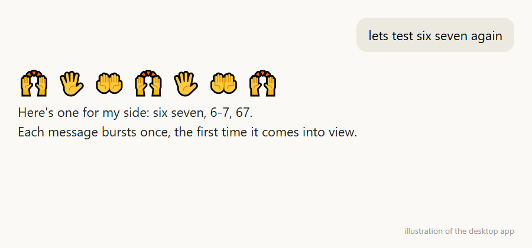

# six-seven 🙌🖐️🤲

A silly Claude Code mod for the "6 7" meme: whenever **67** shows up in the chat, waving hands burst out of that message for about two seconds.



- Matches standalone `67`, `6 7`, `6-7` and `six seven` (so `MG-67` counts), in your messages and Claude's.
- Ignores `1967`, `670`, `$67.50`, `file.ts:67` and anything inside code.
- Each message bursts once, the first time it scrolls into view. While a reply is still streaming, the burst shows above the prompt.
- **Zero tokens:** no model calls, nothing added to the prompt.

## Install

At the prompt of a Claude Code terminal session:

```
/plugin install six-seven --marketplace TheCatchyName/six-seven
```

Answer `y` to add the marketplace, then pick a scope. From a shell:

```bash
claude plugin install six-seven --marketplace TheCatchyName/six-seven
```

In the desktop app: click **+** next to the prompt box → **Plugins** → **Add marketplace** `TheCatchyName/six-seven` → **Add plugin**.

## Develop

```bash
claude plugin validate .
claude plugin test .
```

Run a local copy with `claude --plugin-dir .`.

MIT licensed.
